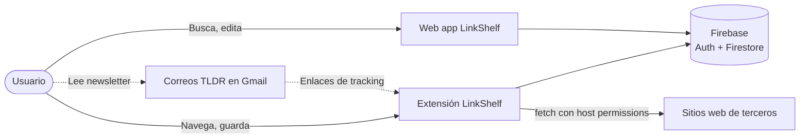
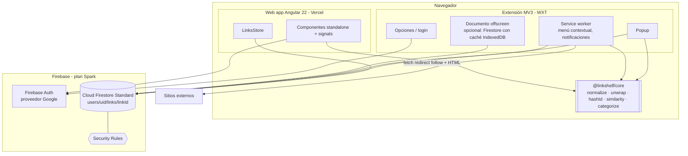
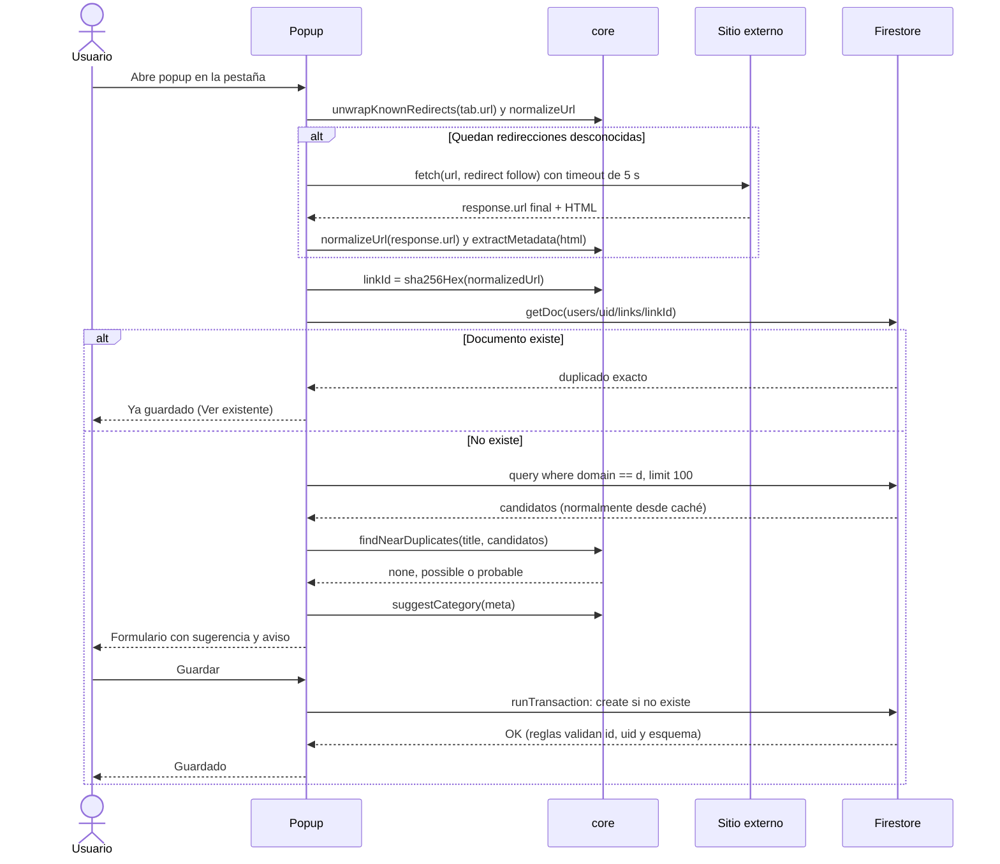

> **Proyecto:** LinkShelf

# Arquitectura

## Visión general
LinkShelf es una aplicación **cliente-pesada sin backend propio**. Dos clientes (web Angular y extensión MV3) comparten el paquete `@linkshelf/core`, que contiene toda la lógica de dominio, y hablan directamente con **Firebase** (Auth + Cloud Firestore) mediante el SDK oficial. La autorización la imponen las **Firestore Security Rules**; no existen Cloud Functions porque requieren el plan Blaze y el proyecto se mantiene en **Spark** (gratis, sin tarjeta).

Consecuencias de este diseño:
- La lógica que antes habría vivido en un servidor (normalizar URLs, quitar tracking, desenvolver redirecciones, sugerir categoría, detectar duplicados) se ejecuta **en el dispositivo del usuario** y es determinista y testeable.
- La integridad que no puede garantizar el cliente (no leer datos ajenos, que el ID del documento coincida con la URL, tipos y tamaños de campos) la garantizan las **reglas**.
- Las operaciones que necesitan red hacia sitios de terceros (seguir redirecciones HTTP, leer `<title>`/`og:*`) solo son posibles donde CORS no aplica: la **extensión** con permisos de host. La web guarda lo que puede y deja metadatos pendientes.

## Diagrama de contexto



## Diagrama de contenedores



## Secuencia: guardar enlace desde la extensión



## Componentes

| Componente | Responsabilidad | Tecnología |
|---|---|---|
| `@linkshelf/core` | `normalizeUrl`, `unwrapKnownRedirects`, `stripTracking`, `linkIdFor` (SHA-256 hex vía Web Crypto), `buildKeywords`, `titleSimilarity` (trigramas + Jaccard), `suggestCategory`, `CATEGORIES` | TypeScript puro, sin dependencias de runtime |
| `@linkshelf/firebase` (subpaquete opcional) | Inicialización del SDK, convertidores tipados (`FirestoreDataConverter<Link>`), repositorio `LinksRepo` usado por web y extensión | Firebase JS SDK modular |
| Web app | Biblioteca, filtros, edición, importación, ajustes | Angular 22, `@angular/fire` opcional (o SDK directo) |
| Extensión | Guardado en un clic, menú contextual, resolución de redirecciones y metadatos con red | WXT, MV3 |
| Security Rules | Aislamiento por usuario, validación de esquema e invariante `linkId == hash` en forma | `firestore.rules` |

## Decisiones de arquitectura (ADR resumidas)

| # | Decisión | Alternativa | Motivo |
|---|---|---|---|
| ADR-01 | Firebase Spark como backend | Supabase Free | Los dos proyectos gratuitos de Supabase del usuario ya están ocupados y Supabase pausa proyectos inactivos; Spark no pausa ni pide tarjeta |
| ADR-02 | Sin Cloud Functions; lógica en `@linkshelf/core` | Functions en Blaze | Mantener $0 sin tarjeta; además la lógica pura es más fácil de probar |
| ADR-03 | ID del documento = SHA-256 hex de la URL normalizada | ID aleatorio + consulta de unicidad | Firestore no tiene restricciones `unique`; con ID determinista un duplicado exacto es imposible por construcción y la verificación cuesta 1 lectura |
| ADR-04 | Subcolección `users/{uid}/links` | Colección raíz `links` con campo `uid` | Reglas más simples (`request.auth.uid == uid`), consultas acotadas sin índice compuesto por usuario, borrado de cuenta por prefijo |
| ADR-05 | Categorías como configuración fija en `core` | `users/{uid}/categories` | El conjunto de 6 categorías es estable; evita lecturas, permite validarlas en las reglas con `in [...]` y versionarlas con tests. La personalización se cubre con etiquetas libres |
| ADR-06 | Búsqueda en el cliente sobre el listener en memoria | Algolia / Typesense / extensión de búsqueda | Unos miles de documentos caben en memoria; las extensiones de búsqueda requieren Blaze |
| ADR-07 | Resolución de redirecciones solo en la extensión | Proxy CORS público | Un proxy de terceros filtraría las URLs y es poco fiable; la extensión tiene permisos de host y no sufre CORS |
| ADR-08 | Vercel para la web | Firebase Hosting | Previews por PR integradas; Firebase Hosting queda como alternativa gratuita equivalente |

## Estructura del monorepo

```
link-manager/
├── apps/
│   ├── web/                       # Angular 22
│   │   ├── src/app/core/          # firebase.providers.ts, auth.service.ts, links.repo.ts
│   │   ├── src/app/features/      # library, link-detail, import, settings
│   │   └── e2e/                   # Playwright
│   └── extension/                 # WXT
│       ├── entrypoints/background.ts
│       ├── entrypoints/popup/
│       ├── entrypoints/options/
│       ├── entrypoints/offscreen/ # solo si se usa caché IndexedDB de Firestore
│       └── lib/
├── packages/
│   ├── core/                      # @linkshelf/core
│   │   ├── src/normalize.ts
│   │   ├── src/unwrap.ts          # TLDR, google.com/url, l.facebook.com…
│   │   ├── src/tracking-params.ts
│   │   ├── src/link-id.ts         # sha256Hex(normalizedUrl)
│   │   ├── src/similarity.ts      # trigramas, Jaccard, keywords
│   │   ├── src/categorize.ts
│   │   ├── src/categories.ts      # configuración fija
│   │   └── test/
│   └── firebase/                  # @linkshelf/firebase (convertidores y repositorio)
├── firebase/
│   ├── firestore.rules
│   ├── firestore.indexes.json
│   └── tests/rules.test.ts
├── firebase.json
├── .firebaserc
├── .github/workflows/
├── pnpm-workspace.yaml
├── package.json
└── tsconfig.base.json
```

## Estado en el cliente web
- Un `LinksStore` basado en `signal`/`computed` mantiene filtros y resultados; los filtros se sincronizan con query params del router.
- El store se alimenta de un `onSnapshot` sobre `users/{uid}/links` (ordenado por `createdAt desc`); los cambios hechos desde la extensión aparecen en la web en tiempo real.
- El filtrado por texto, etiquetas y dominio se hace con `computed()` sobre el arreglo en memoria; categoría y estado pueden empujarse a la consulta de Firestore si la colección crece mucho.
- Aplicación **zoneless** (`provideZonelessChangeDetection()`): los callbacks del SDK actualizan signals y no necesitan zone.js.
- Persistencia local: `initializeFirestore(app, { localCache: persistentLocalCache({ tabManager: persistentMultipleTabManager() }) })`.
