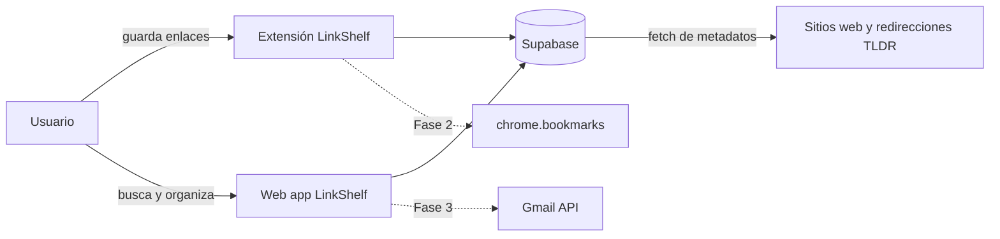
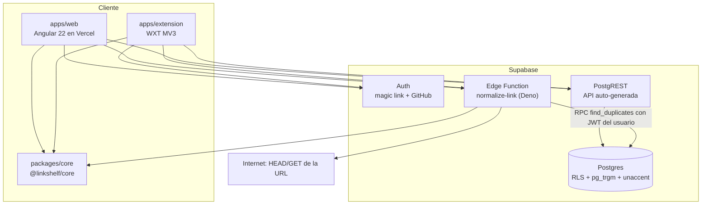
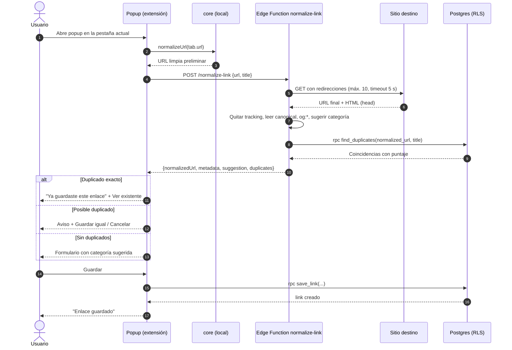

> **Proyecto:** LinkShelf

# Arquitectura

## Visión general
Arquitectura *serverless* con Supabase como backend (BaaS). Los clientes (web Angular y extensión WXT) hablan directo con Postgres vía PostgREST protegidos por RLS, y con una única Edge Function `normalize-link` para la lógica que requiere red (redirecciones, metadatos). La lógica pura (normalizar URL, quitar tracking, reglas de categoría) vive en `@linkshelf/core` y se reutiliza en los tres lugares: web, extensión y Edge Function (Deno importa el paquete vía ruta relativa / `npm:` en el build).

## Diagrama de contexto



## Diagrama de contenedores



## Secuencia: guardar enlace desde la extensión



## Componentes

| Componente | Responsabilidad | Tecnología |
|---|---|---|
| `packages/core` | `normalizeUrl`, `stripTracking`, `normalizeGithubUrl`, `suggestCategory`, `titleSimilarity` (para pruebas locales), tipos compartidos (`Link`, `CategorySlug`, DTOs de la API) | TS puro, sin dependencias de DOM/Node |
| `apps/web` | Login, listado, filtros, edición, gestión de etiquetas, importación (fase 2+) | Angular 22, signals, `@supabase/supabase-js` |
| `apps/extension` | Popup, menú contextual, background service worker, opciones | WXT, TS, Preact o vanilla en el popup |
| `supabase/functions/normalize-link` | Red: redirecciones, metadatos, dedupe | Deno, `deno-dom` para parsear HTML |
| `supabase/migrations` | Esquema, índices, RLS, RPCs | SQL |

## Decisiones de arquitectura (ADR resumidas)

| ADR | Decisión | Motivo |
|---|---|---|
| ADR-01 | Clientes acceden a la BD vía PostgREST + RLS, sin backend propio | Menos piezas, $0, seguridad declarativa |
| ADR-02 | Una sola Edge Function para la lógica de red | El navegador no puede seguir redirecciones cross-origin ni leer HTML ajeno (CORS) desde la web |
| ADR-03 | La normalización pura vive en `core` y se ejecuta también localmente | Respuesta instantánea y fallback si la función falla (RNF-10) |
| ADR-04 | Inserción vía RPC `save_link` (transacción enlace + etiquetas) | Atomicidad y validación en servidor |
| ADR-05 | Monorepo pnpm | Compartir `core` y tipos sin publicar en npm |

## Estructura del monorepo

```
link-manager/
├── apps/
│   ├── web/
│   │   ├── src/app/
│   │   │   ├── core/            # servicios: supabase.client, auth, links.store (signals)
│   │   │   ├── features/
│   │   │   │   ├── auth/
│   │   │   │   ├── links/       # list, detail, edit, filters
│   │   │   │   ├── tags/
│   │   │   │   └── import/      # fase 2+
│   │   │   └── shared/ui/       # componentes presentacionales
│   │   ├── e2e/                 # Playwright
│   │   └── angular.json
│   └── extension/
│       ├── entrypoints/
│       │   ├── background.ts    # service worker: menú contextual, auth refresh
│       │   ├── popup/
│       │   └── options/
│       ├── lib/                 # api.ts, storage.ts
│       └── wxt.config.ts
├── packages/
│   └── core/
│       ├── src/
│       │   ├── normalize.ts
│       │   ├── tracking-params.ts
│       │   ├── github.ts
│       │   ├── categorize.ts
│       │   └── types.ts
│       └── test/
├── supabase/
│   ├── config.toml
│   ├── migrations/
│   ├── functions/normalize-link/index.ts
│   └── seed.sql
├── .github/workflows/ci.yml
├── pnpm-workspace.yaml
├── package.json
└── tsconfig.base.json
```

## Estado en el cliente web
- Un `LinksStore` basado en `signal`/`computed` mantiene filtros y resultados; los filtros se sincronizan con query params del router.
- Aplicación **zoneless** (`provideZonelessChangeDetection()`), ya estándar en Angular moderno: todo el estado reactivo es signals, lo que hace innecesario zone.js.
- `resource()`/`httpResource` para cargas dependientes de filtros.
