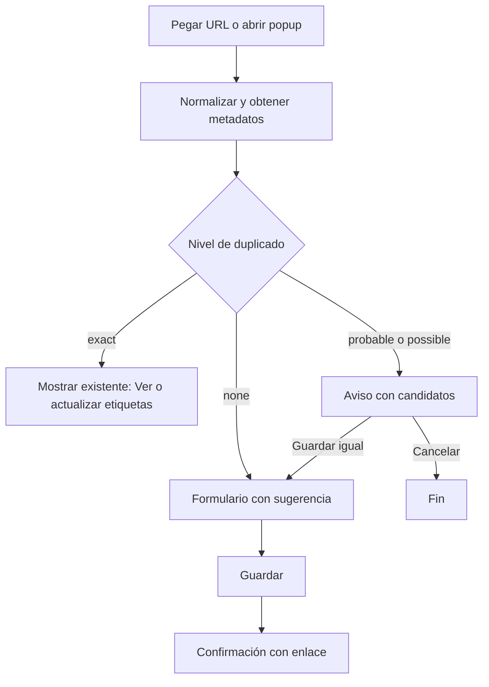

> **Proyecto:** LinkShelf

# Diseño UI/UX

## Principios
1. **Guardar es instantáneo**, organizar es opcional (la sugerencia hace el trabajo).
2. **Nada se pierde en silencio**: los duplicados se avisan, no se descartan.
3. **Densidad útil**: ver muchos enlaces a la vez, con filtros siempre visibles.
4. **Teclado primero**: búsqueda con `/`, navegación con `j`/`k`, `e` editar.

## Pantallas (web)

| # | Ruta | Pantalla | Contenido |
|---|---|---|---|
| P1 | `/login` | Inicio de sesión | Botón *Continuar con Google* (Firebase Auth) |
| P2 | `/links` | Biblioteca (principal) | Sidebar de categorías con conteos, barra de búsqueda, chips de filtros, lista/tarjetas |
| P3 | `/links/new` | Guardar enlace | Pegar URL → misma lógica que el popup |
| P4 | `/links/:id` | Detalle / edición | Metadatos, categoría, etiquetas, nota, URL original vs. normalizada |
| P5 | `/tags` | Etiquetas | Renombrar, fusionar, borrar, conteos |
| P6 | `/duplicates` | Revisión de duplicados | Pares de posibles duplicados existentes con *Fusionar* / *No es duplicado* |
| P7 | `/import` | Importar (Fase 2-3) | Subir HTML, Chrome, Gmail; vista previa del lote e informe |
| P8 | `/settings` | Ajustes | Categoría por defecto, tema, LLM opcional, exportar, cerrar sesión |

## Wireframes

### P2 Biblioteca (escritorio)
```
┌───────────────────────────────────────────────────────────────────────┐
│ ⚓ LinkShelf   [🔍 Buscar enlaces…  (/)              ]  [+ Guardar] 👤│
├──────────────┬────────────────────────────────────────────────────────┤
│ Todas    412 │ Filtros: [IA ×] [#tutorial ×] [dominio: github.com ×]  │
│ Artículos 38 │ Orden: [Más recientes ▾]   Vista: [☰ lista | ▦ tarjetas]│
│ Tutoriales 91├────────────────────────────────────────────────────────┤
│ Projects 120 │ ▣ vercel/ai: The AI Toolkit for TypeScript             │
│ WebPages  64 │   github.com · Projects · #ia #typescript · hace 2 d   │
│ IA        70 │ ▣ Cómo construir un agente con TypeScript              │
│ Diseño    29 │   blog.example.com · Tutoriales · #ia · hace 5 d       │
│──────────────│ ▣ Attention Is All You Need                            │
│ Etiquetas    │   arxiv.org · Artículos · #ia · 14/10/2026             │
│ #ia       85 │                                                        │
│ #tutorial 40 │                  … scroll infinito (30 por página)     │
│ ⚠ Duplicados 3│                                                       │
└──────────────┴────────────────────────────────────────────────────────┘
```

### P2 Biblioteca (móvil)
```
┌─────────────────────────┐
│ ☰  LinkShelf   🔍  [+] │
│ [Todas][IA][Tutoriales]→│  ← chips desplazables
├─────────────────────────┤
│ vercel/ai               │
│ github.com · Projects   │
├─────────────────────────┤
│ Cómo construir un…      │
│ blog.example.com · Tut. │
└─────────────────────────┘
```

### Flujo de guardado


## Filtros
- **Categoría** (una, sidebar) + toggle *incluir etiquetas homónimas*.
- **Etiquetas** (múltiples, modo *cualquiera*/*todas*).
- **Dominio** (autocompletado con los dominios presentes).
- **Fecha** (hoy, 7 días, 30 días, rango).
- **Estado** (Fase 3): no leídos, favoritos.
- **Texto** difuso con resaltado de coincidencias.
- Todo se refleja en query params: `/links?cat=ia&tags=tutorial&tagMode=all&domain=github.com&q=agente&from=2026-10-01`.

## Guía visual

### Color
| Token | Claro | Oscuro | Uso |
|---|---|---|---|
| `--ls-bg` | `#f8fafc` | `#0b1220` | Fondo |
| `--ls-surface` | `#ffffff` | `#111a2e` | Tarjetas |
| `--ls-text` | `#0f172a` | `#e2e8f0` | Texto |
| `--ls-muted` | `#475569` | `#94a3b8` | Secundario (contraste ≥ 4,5:1) |
| `--ls-primary` | `#0e7490` | `#22d3ee` | Acción principal (tema "puerto": azul petróleo) |
| `--ls-warning` | `#b45309` | `#fbbf24` | Aviso de duplicado |
| `--ls-danger` | `#b91c1c` | `#f87171` | Eliminar |

Colores de categoría: los de la configuración `CATEGORIES` de `@linkshelf/core` (siempre acompañados de texto, nunca solo color). Tema claro/oscuro según `prefers-color-scheme` con selector manual.

### Tipografía
- **Inter** (variable) para UI, **JetBrains Mono** para URLs; ambas en Google Fonts / autohospedadas.
- Escala: 12 / 14 (base lista) / 16 (base) / 20 / 24 / 32 px; interlineado 1,5.

### Espaciado y componentes
- Escala de 4 px; radios 8 px; sombras suaves solo en elementos flotantes.
- Componentes base: `ls-link-card`, `ls-category-badge`, `ls-tag-chip`, `ls-duplicate-alert`, `ls-filter-bar`, `ls-empty-state`.

## Accesibilidad (WCAG 2.2 AA)
- Contraste ≥ 4,5:1 en texto y ≥ 3:1 en componentes.
- Navegación completa con teclado, foco visible (`:focus-visible` 2 px `--ls-primary`).
- El aviso de duplicado usa `role="alert"` / `aria-live="polite"`.
- Chips de etiqueta con botón de quitar etiquetado ("Quitar etiqueta ia").
- Respeta `prefers-reduced-motion`.
- Objetivos táctiles ≥ 24×24 px (44 px en móvil).
- `lang="es-419"` y fechas con `Intl.DateTimeFormat('es-419')`.
- Pruebas automáticas con `@axe-core/playwright`.

## Microcopy
- Guardar: "Enlace guardado". Exacto: "Ya guardaste este enlace". Cercano: "Posible duplicado". Limpieza: "Quitamos 2 parámetros de rastreo". Vacío: "Aún no hay enlaces. Guarda el primero desde la extensión o con *+ Guardar*".
