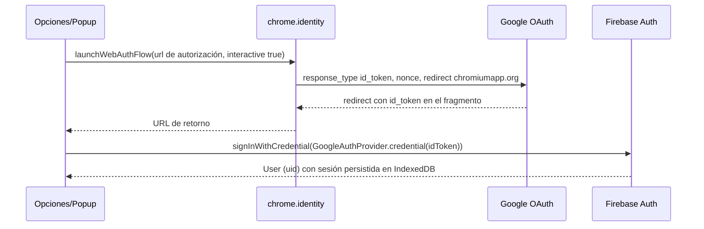

> **Proyecto:** LinkShelf

# Extensión de navegador

Construida con **WXT** (Vite) + TypeScript, Manifest V3. Un solo código genera builds para Chrome, Edge, Brave (Chromium) y Firefox (`wxt build -b firefox`).

## Entrypoints

| Archivo | Rol |
|---|---|
| `entrypoints/background.ts` | Service worker: registra el menú contextual, maneja guardado desde menú, mantiene la sesión de Firebase Auth, completa metadatos pendientes (`chrome.alarms`), muestra notificaciones |
| `entrypoints/popup/` | UI de guardado de la pestaña actual |
| `entrypoints/options/` | Login/logout con Google, categoría por defecto, URL de la web, permiso de host para resolver redirecciones, importación de favoritos |
| `entrypoints/offscreen/` (opcional) | Documento offscreen que aloja Firestore con caché persistente en IndexedDB y se comunica por `runtime.sendMessage` |
| `lib/firebase.ts` | `initializeApp` + `initializeAuth` (build `firebase/auth/web-extension`) + `initializeFirestore` |
| `lib/save.ts` | Orquesta `prepareLink` de core, `resolveRedirects` y `LinksRepo` |
| `lib/prefs.ts` | Preferencias en `chrome.storage.local` |

## Permisos (mínimos) y justificación

| Permiso | Por qué | Alternativa descartada |
|---|---|---|
| `activeTab` | Leer URL y título de la pestaña **solo** cuando el usuario abre el popup o usa el menú | `tabs` (acceso a todas las pestañas, más invasivo) |
| `contextMenus` | Entrada *Guardar enlace* / *Guardar esta página* | — |
| `storage` | Preferencias (la sesión de Firebase Auth usa IndexedDB, disponible en service workers) | `localStorage` no existe en service workers |
| `notifications` | Confirmar guardados desde el menú contextual | Badge del ícono (se usa además) |
| `identity` | Login con Google mediante `launchWebAuthFlow` | `signInWithPopup` (no funciona en MV3: requiere código remoto/iframes de `firebaseapp.com`) |
| `offscreen` (si se usa el documento offscreen) | Mantener Firestore con caché IndexedDB y conexión persistente fuera del ciclo de vida del service worker | — |
| `alarms` | Completar metadatos pendientes cada 6 h | — |
| `bookmarks` (**opcional**, `optional_permissions`) | Importar favoritos (Fase 2); se pide en tiempo de ejecución con `chrome.permissions.request` | Pedirlo en la instalación |
| `host_permissions`: `https://firestore.googleapis.com/*`, `https://identitytoolkit.googleapis.com/*`, `https://securetoken.googleapis.com/*` | Hablar con Firestore y Auth | — |
| `optional_host_permissions`: `https://*/*`, `http://*/*` | Seguir redirecciones y leer `<title>`/`og:*` sin CORS. Se pide en *Opciones* con `permissions.request`; sin él se usa la URL final de la pestaña | Pedirlo en la instalación (aviso "leer y cambiar todos tus datos") |

**No** se usan content scripts: no se inyecta código en las páginas. La lectura de HTML ajeno se hace con `fetch` desde la extensión, nunca ejecutando scripts del sitio.

## Popup (UX)

```
┌──────────────────────────────────────┐
│ ⚓ LinkShelf                 ⚙  👤  │
├──────────────────────────────────────┤
│ [og:image miniatura]                 │
│ Título editable ___________________  │
│ example.com/blog/post   🧹 2 params  │
│                                      │
│ ⚠ Posible duplicado (92 %)           │
│   "Cómo construir un agente…"  Ver ↗ │
│                                      │
│ Categoría  [ Tutoriales ▾ ] ✨sugerida│
│ Etiquetas  [ia ×] [typescript ×] [+] │
│ Nota       _______________________   │
│                                      │
│ [ Cancelar ]        [ Guardar igual ]│
└──────────────────────────────────────┘
```

Estados: *cargando* (skeleton, < 3 s), *listo*, *duplicado exacto* (botón principal = *Ver existente*), *posible duplicado*, *guardado* (check + enlace a la web, autocierre 2 s), *error* (reintentar / guardar con datos locales), *sin sesión* (botón *Iniciar sesión*).

Atajo de teclado: `Ctrl+Shift+S` (`commands` → `_execute_action`), `Enter` guarda, `Esc` cierra.

## Menú contextual
- `contexts: ['link']` → **Guardar enlace** (usa `info.linkUrl`, ideal para guardar desde el correo TLDR en Gmail sin abrir el enlace).
- `contexts: ['page']` → **Guardar esta página**.
- Flujo: `prepareLink` (core) → `resolveRedirects` si hay permiso de host (el enlace no está abierto en una pestaña) → `getById` → si `exact` notifica "Ya estaba guardado"; si `possible`/`probable` notifica "Posible duplicado — abre el popup para decidir" y **no guarda**; si `none` guarda con la categoría sugerida y notifica con botón *Deshacer* (10 s, hace `deleteDoc`).

## Autenticación desde la extensión (Firebase Auth + Google)

### Restricciones de MV3 con el Firebase JS SDK
- **Sin código remoto**: MV3 prohíbe cargar scripts de otro origen. `signInWithPopup` y `signInWithRedirect` dependen de un iframe/handler en `<project>.firebaseapp.com/__/auth/handler`, así que **no se usan**.
- Importar Auth desde **`firebase/auth/web-extension`** (build para extensiones, disponible desde Firebase JS SDK v11): no incluye el código de reCAPTCHA/GAPI que se carga remotamente y que la Chrome Web Store rechaza.
- Usar `initializeAuth(app, { persistence: indexedDBLocalPersistence })` en lugar de `getAuth()` para no arrastrar dependencias de popup/redirect.
- El **service worker se apaga** tras ~30 s de inactividad: no guardar estado en variables globales; `onAuthStateChanged` se re-registra en cada arranque y la sesión se recupera de IndexedDB.
- Firestore en el service worker funciona con caché en memoria; para caché persistente (IndexedDB con pestañas múltiples) y un listener `onSnapshot` duradero, usar un **documento offscreen** (`chrome.offscreen.createDocument({ reasons: ['LOCAL_STORAGE'], … })`). En el MVP basta con caché en memoria y consultas puntuales.
- CSP por defecto de MV3 (`script-src 'self'`): todo el SDK se empaqueta con Vite; nada de `eval`.

### Flujo con `chrome.identity.launchWebAuthFlow` + `signInWithCredential`



```ts
import { initializeAuth, indexedDBLocalPersistence, GoogleAuthProvider, signInWithCredential } from 'firebase/auth/web-extension';

export const auth = initializeAuth(app, { persistence: indexedDBLocalPersistence });

export async function signInWithGoogle() {
  const nonce = crypto.randomUUID();
  const url = new URL('https://accounts.google.com/o/oauth2/v2/auth');
  url.search = new URLSearchParams({
    client_id: import.meta.env.WXT_GOOGLE_OAUTH_CLIENT_ID,
    response_type: 'id_token',
    redirect_uri: browser.identity.getRedirectURL(),   // https://<extension-id>.chromiumapp.org/
    scope: 'openid email profile',
    nonce,
    prompt: 'select_account',
  }).toString();
  const redirect = await browser.identity.launchWebAuthFlow({ url: url.toString(), interactive: true });
  const idToken = new URLSearchParams(new URL(redirect!).hash.slice(1)).get('id_token');
  if (!idToken) throw new Error('Login cancelado');
  return signInWithCredential(auth, GoogleAuthProvider.credential(idToken));
}
```

Configuración necesaria:
1. En Google Cloud Console (mismo proyecto de Firebase), el **client ID OAuth de tipo Aplicación web** creado por Firebase: añadir `https://<extension-id>.chromiumapp.org/` (Chrome/Edge/Brave) y la URL de `identity.getRedirectURL()` de Firefox (`https://<hash>.extensions.allizom.org/`) como URIs de redirección autorizadas.
2. Firebase Auth → *Authorized domains*: añadir `<extension-id>.chromiumapp.org` si se usan flujos que validen dominio.
3. `chrome.identity.getAuthToken` **no** se usa: solo existe en Chrome (no en Edge/Firefox) y devuelve un access token, no un ID token.

Alternativa sin flujo propio: la extensión abre la web app (`/extension-login`), donde el usuario ya inició sesión, y la web le pasa un ID token de Google mediante `chrome.runtime.sendMessage` con `externally_connectable`. Se documenta como plan B si el flujo anterior da problemas en algún navegador.

### ID estable
Fijar `key` en el manifest de desarrollo para que el `extension-id` (y la redirect URL) no cambie entre instalaciones.

## Importación de favoritos (Fase 2)
- Opción A: `chrome.bookmarks.getTree()` tras permiso opcional; recorrer el árbol, mapear carpeta → categoría por nombre (`Articulos` → `articulos`, etc.), resto → sugerencia por reglas.
- Opción B (web, sin permisos): subir el HTML exportado (formato Netscape) y parsearlo con `DOMParser`.
- Ambas: normalizar en local con `core`, calcular IDs, deduplicar dentro del lote (mismo ID), comprobar existentes contra el listener/consulta de la colección, crear con `writeBatch` de hasta 500 y registrar `users/{uid}/importBatches/{batchId}`. Los metadatos quedan `pending` y los completa la alarma de la extensión de a poco (sin agotar cuota ni saturar sitios).

## Cross-browser

| Navegador | Build | Notas |
|---|---|---|
| Chrome / Brave | `wxt build` | Brave usa la misma build y tienda de Chrome |
| Edge | `wxt build -b edge` | Edge Add-ons, publicación gratuita |
| Firefox | `wxt build -b firefox --mv3` | `browser_specific_settings.gecko.id`; service worker → background scripts (WXT lo maneja); `identity.launchWebAuthFlow` soportado |
| Safari | Fuera de alcance | Requiere Xcode y cuenta Apple de pago |

Usar `browser.*` de WXT (polyfill de `webextension-polyfill`) en lugar de `chrome.*` directo.
