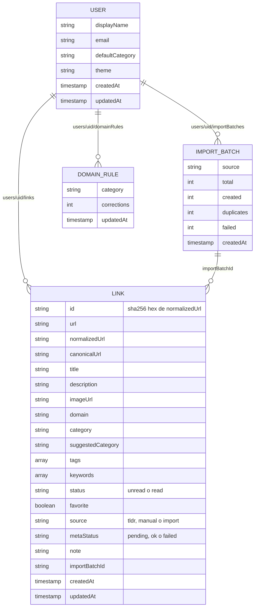

> **Proyecto:** LinkShelf

# Modelo de datos (Cloud Firestore)

Base de datos: **Cloud Firestore, edición Standard, modo nativo**, base `(default)`. Firestore es documental: no hay tablas, claves foráneas ni restricciones `unique`; la integridad se obtiene con **IDs deterministas**, **transacciones** y **Security Rules** (ver [seguridad.md](seguridad.md)).

## Árbol de colecciones

```
users/{uid}                          ← documento de perfil y preferencias
  └── links/{linkId}                 ← un documento por enlace; linkId = sha256Hex(normalizedUrl)
  └── importBatches/{batchId}        ← Fase 2: informe y reversión de importaciones
  └── domainRules/{domain}           ← Fase 3: reglas personales aprendidas de correcciones
```



## Documento `users/{uid}/links/{linkId}`

| Campo               | Tipo Firestore  | Obligatorio         | Descripción / validación                                                                                                                             |
| ------------------- | --------------- | ------------------- | ---------------------------------------------------------------------------------------------------------------------------------------------------- |
| _(ID)_              | string          | sí                  | `sha256Hex(normalizedUrl)`: 64 caracteres `[0-9a-f]`. Lo calcula `@linkshelf/core` con `crypto.subtle.digest('SHA-256', …)`                          |
| `url`               | string          | sí                  | URL tal como se recibió (tras quitar espacios), ≤ 2 048 caracteres. Se conserva para auditoría                                                       |
| `normalizedUrl`     | string          | sí                  | Salida de `normalizeUrl` (sin tracking, sin wrappers conocidos). Fuente del ID                                                                       |
| `canonicalUrl`      | string \| null  | no                  | `rel=canonical`/`og:url` normalizado si es del mismo dominio registrable (solo cuando la extensión pudo leer el HTML)                                |
| `title`             | string          | sí                  | 1–500 caracteres. Si no hay metadatos: título de la pestaña o la propia URL                                                                          |
| `description`       | string \| null  | no                  | `og:description`/`meta description`, ≤ 1 000 caracteres                                                                                              |
| `imageUrl`          | string \| null  | no                  | `og:image` absoluto (se muestra como miniatura; no se descarga ni se guarda)                                                                         |
| `domain`            | string          | sí                  | Host registrable sin `www.` (`github.com`, `blog.example.com` → `example.com` según la Public Suffix List embebida en core)                          |
| `category`          | string          | sí                  | Uno de `articulos`, `tutoriales`, `projects`, `webpages`, `ia`, `diseno`                                                                             |
| `suggestedCategory` | string \| null  | no                  | Lo que propuso `suggestCategory`; si difiere de `category` es una corrección (aprendizaje Fase 3)                                                    |
| `tags`              | array\<string\> | sí (puede ser `[]`) | 0–10 etiquetas, minúsculas, sin acentos, `^[a-z0-9-]{1,32}$`                                                                                         |
| `keywords`          | array\<string\> | sí                  | Tokens del título normalizados + trigramas seleccionados (ver abajo), ≤ 60 elementos. Sirve para `array-contains-any` y para similitud en el cliente |
| `status`            | string          | sí                  | `unread` (por defecto) o `read`                                                                                                                      |
| `favorite`          | boolean         | sí                  | `false` por defecto                                                                                                                                  |
| `source`            | string          | sí                  | `tldr` (URL original de `tldrnewsletter.com` o `utm_source=tldr*`), `manual` o `import`                                                              |
| `metaStatus`        | string          | sí                  | `ok`, `pending` (guardado desde la web sin poder leer el sitio) o `failed`                                                                           |
| `note`              | string \| null  | no                  | Nota libre, ≤ 2 000 caracteres                                                                                                                       |
| `importBatchId`     | string \| null  | no                  | Fase 2                                                                                                                                               |
| `createdAt`         | timestamp       | sí                  | `serverTimestamp()`; las reglas exigen `request.time`                                                                                                |
| `updatedAt`         | timestamp       | sí                  | `serverTimestamp()` en cada escritura                                                                                                                |

Tamaño típico: 1–2 KB por documento (límite de Firestore: 1 MiB).

### Ejemplo

```json
// users/Xk3…/links/9f2c…e41a
{
  "url": "https://tracking.tldrnewsletter.com/CL0/https:%2F%2Fgithub.com%2Flangchain-ai%2Flanggraph%3Futm_source=tldrai/1/0100…",
  "normalizedUrl": "https://github.com/langchain-ai/langgraph",
  "canonicalUrl": "https://github.com/langchain-ai/langgraph",
  "title": "LangGraph: build resilient language agents as graphs",
  "description": "Build resilient language agents as graphs.",
  "imageUrl": "https://opengraph.githubassets.com/…/langchain-ai/langgraph",
  "domain": "github.com",
  "category": "projects",
  "suggestedCategory": "projects",
  "tags": ["ia", "agentes"],
  "keywords": [
    "langgraph",
    "build",
    "resilient",
    "language",
    "agents",
    "graphs",
    "lan",
    "ang",
    "ngg",
    "…"
  ],
  "status": "unread",
  "favorite": false,
  "source": "tldr",
  "metaStatus": "ok",
  "note": null,
  "importBatchId": null,
  "createdAt": "2026-11-02T18:40:00Z",
  "updatedAt": "2026-11-02T18:40:00Z"
}
```

### Por qué el ID es el hash de la URL normalizada

- Firestore no ofrece restricciones de unicidad. Con un ID aleatorio, dos guardados concurrentes (popup + menú contextual, o web + extensión) podrían crear dos documentos para la misma URL.
- Con `linkId = sha256Hex(normalizedUrl)` ambos clientes calculan **el mismo ID**; el segundo `create` falla (transacción o regla `!exists`) y el duplicado exacto es **imposible por construcción**.
- Verificar si ya existe cuesta **una lectura** (`getDoc`), sin índices.
- SHA-256 en hex evita caracteres prohibidos en IDs (`/`) y longitudes > 1 500 bytes.
- Si cambia el algoritmo de normalización (nueva regla de tracking), se ejecuta una **migración en el cliente** (Fase 2, pantalla de mantenimiento): recalcula IDs y fusiona colisiones (conserva `createdAt` más antiguo y une etiquetas).

### Campo `keywords`

Generado por `buildKeywords(title)` en core:

1. `lower` + quitar acentos (`normalize('NFD')` y quitar diacríticos) + quitar puntuación.
2. Tokens de ≥ 3 caracteres que no sean _stopwords_ (lista ES+EN).
3. Trigramas de los primeros tokens (con relleno `  x`), deduplicados, hasta completar 60 elementos.

Usos: búsqueda aproximada con `where('keywords','array-contains-any', [...hasta 30 valores])` cuando no se tiene la colección en memoria, y comparación Jaccard rápida para duplicados cercanos.

## Documento `users/{uid}`

| Campo                              | Tipo      | Descripción                                                                                                        |
| ---------------------------------- | --------- | ------------------------------------------------------------------------------------------------------------------ |
| `displayName`, `email`, `photoURL` | string    | Copiados del perfil de Google al primer login (solo lectura en la UI)                                              |
| `defaultCategory`                  | string    | Categoría si la confianza es baja (por defecto `webpages`)                                                         |
| `theme`                            | string    | `system`, `light` o `dark`                                                                                         |
| `similarityThresholds`             | map       | `{ probable: 0.8, possible: 0.6 }` (ajustable, ver [normalizacion-y-duplicados.md](normalizacion-y-duplicados.md)) |
| `normalizerVersion`                | number    | Versión del normalizador con la que se generaron los IDs; dispara la migración                                     |
| `createdAt`, `updatedAt`           | timestamp |                                                                                                                    |

## Categorías: configuración fija en `@linkshelf/core`

**Decisión:** las categorías son una constante versionada en `packages/core/src/categories.ts`, **no** una subcolección `users/{uid}/categories`.

```ts
export const CATEGORIES = [
  { slug: 'articulos', name: 'Artículos', icon: 'science', order: 1, color: '#0369a1' },
  { slug: 'tutoriales', name: 'Tutoriales', icon: 'school', order: 2, color: '#7c3aed' },
  { slug: 'projects', name: 'Projects', icon: 'code', order: 3, color: '#0f766e' },
  { slug: 'webpages', name: 'WebPages', icon: 'language', order: 4, color: '#c2410c' },
  { slug: 'ia', name: 'IA', icon: 'smart_toy', order: 5, color: '#6d28d9' },
  { slug: 'diseno', name: 'Diseño', icon: 'palette', order: 6, color: '#be185d' },
] as const;
export type CategorySlug = (typeof CATEGORIES)[number]['slug'];
```

Justificación:

- El conjunto es pequeño y estable, y las **reglas de categorización** (ver [categorizacion.md](categorizacion.md)) dependen de los slugs: tenerlos en código permite tipado exhaustivo y tests.
- **Cero lecturas** extra por sesión y sin estado inconsistente entre web y extensión.
- Las Security Rules validan `category in ['articulos', …]` sin leer otro documento (un `get()` en reglas cuesta una lectura facturable).
- La personalización que el usuario necesita (subtemas, "ia" dentro de un tutorial) ya la dan las **etiquetas libres**.
- Si en el futuro se quisieran categorías propias, se añadiría `users/{uid}/categories` y se relajaría la regla; queda documentado como posible Fase 5.

## Etiquetas

No hay colección de etiquetas: viven en el arreglo `tags` de cada enlace. La lista para autocompletar y los contadores se derivan en el cliente del listener en memoria (`Map<tag, count>`). Renombrar una etiqueta = `writeBatch` que actualiza los enlaces afectados (≤ 500 por lote).

## Índices

Firestore crea índices de campo único automáticamente. Índices compuestos en `firebase/firestore.indexes.json`:

| Colección | Campos                                  | Uso                                                 |
| --------- | --------------------------------------- | --------------------------------------------------- |
| `links`   | `category` ASC, `createdAt` DESC        | Lista filtrada por categoría                        |
| `links`   | `status` ASC, `createdAt` DESC          | Pendientes de leer                                  |
| `links`   | `favorite` ASC, `createdAt` DESC        | Favoritos                                           |
| `links`   | `tags` ARRAY_CONTAINS, `createdAt` DESC | Filtro por etiqueta                                 |
| `links`   | `domain` ASC, `createdAt` DESC          | Candidatos a duplicado cercano y filtro por dominio |

Exenciones (para ahorrar almacenamiento de índices): `description`, `note`, `imageUrl`, `url` y `canonicalUrl` sin índice de campo único (no se consultan).

```json
{
  "indexes": [
    {
      "collectionGroup": "links",
      "queryScope": "COLLECTION",
      "fields": [
        { "fieldPath": "category", "order": "ASCENDING" },
        { "fieldPath": "createdAt", "order": "DESCENDING" }
      ]
    },
    {
      "collectionGroup": "links",
      "queryScope": "COLLECTION",
      "fields": [
        { "fieldPath": "domain", "order": "ASCENDING" },
        { "fieldPath": "createdAt", "order": "DESCENDING" }
      ]
    }
  ],
  "fieldOverrides": [
    { "collectionGroup": "links", "fieldPath": "description", "indexes": [] },
    { "collectionGroup": "links", "fieldPath": "note", "indexes": [] }
  ]
}
```

## Escrituras atómicas

- **Crear:** `runTransaction` → `get(ref)`; si existe → `exact`; si no → `set(ref, data)`. Las reglas además exigen que en `create` el documento no exista (`set` sobre existente es `update` y no pasa la validación de `createdAt` inmutable).
- **Editar:** `updateDoc` con lista blanca de campos editables (`title`, `category`, `tags`, `status`, `favorite`, `note`, `description`, `imageUrl`, `metaStatus`, `canonicalUrl`, `updatedAt`).
- **Cambiar URL**: no se permite editar `normalizedUrl`; se crea un documento nuevo y se borra el anterior en un `writeBatch`.
- **Borrar cuenta:** el cliente borra `links` por lotes de 500 y luego `users/{uid}`; después `deleteUser()` en Auth.

## Notas de diseño

- `createdAt`/`updatedAt` siempre con `serverTimestamp()` para que el orden no dependa del reloj del dispositivo.
- Los convertidores (`FirestoreDataConverter<Link>`) en `@linkshelf/firebase` validan con `zod` al leer, para tolerar documentos antiguos.
- Exportación: botón _Exportar JSON_ que serializa el listener en memoria (sin costo extra de lecturas). Respaldo programado: ver [despliegue-y-ci.md](despliegue-y-ci.md).
