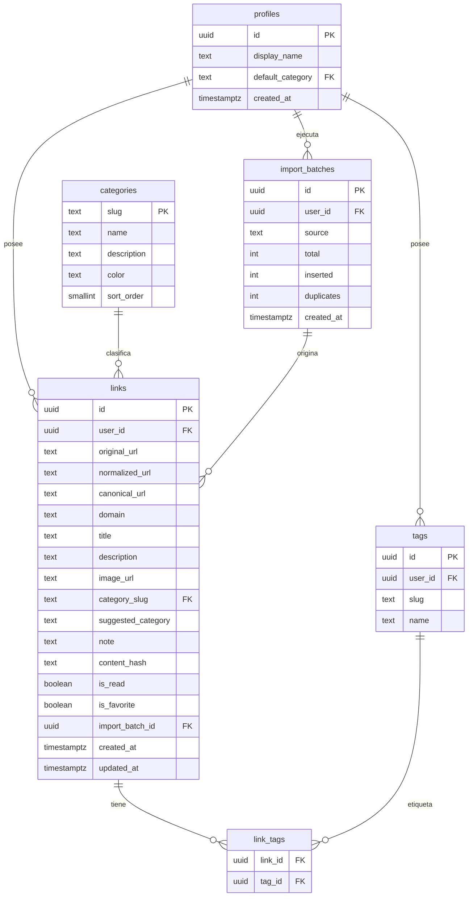

> **Proyecto:** LinkShelf

# Modelo de datos

Postgres (Supabase). Extensiones: `pg_trgm`, `unaccent`, `pgcrypto` (UUID). Todas las tablas en el esquema `public` con **RLS activada**.

## Diagrama ER



## DDL (migración `0001_init.sql`)

```sql
create extension if not exists pg_trgm;
create extension if not exists unaccent;

-- unaccent no es IMMUTABLE; envoltura para poder indexar
create or replace function public.f_unaccent(text)
returns text language sql immutable parallel safe strict
as $$ select public.unaccent('public.unaccent'::regdictionary, $1) $$;

create table public.categories (
  slug        text primary key check (slug ~ '^[a-z0-9-]+$'),
  name        text not null,
  description text not null,
  color       text not null,
  sort_order  smallint not null default 0
);

insert into public.categories (slug, name, description, color, sort_order) values
  ('articulos',  'Artículos',  'Artículos científicos de distintas disciplinas', '#2563eb', 1),
  ('tutoriales', 'Tutoriales', 'Guías paso a paso', '#16a34a', 2),
  ('projects',   'Projects',   'Repositorios de GitHub interesantes', '#7c3aed', 3),
  ('webpages',   'WebPages',   'Sitios interactivos: juegos, apps, assets', '#ea580c', 4),
  ('ia',         'IA',         'Todo lo relacionado con inteligencia artificial', '#db2777', 5),
  ('diseno',     'Diseño',     'Diseño y diseño web', '#0891b2', 6);

create table public.profiles (
  id               uuid primary key references auth.users(id) on delete cascade,
  display_name     text,
  default_category text references public.categories(slug) default 'webpages',
  created_at       timestamptz not null default now()
);

create table public.import_batches (
  id         uuid primary key default gen_random_uuid(),
  user_id    uuid not null default auth.uid() references public.profiles(id) on delete cascade,
  source     text not null check (source in ('chrome_html','chrome_api','gmail_tldr','json')),
  total      int not null default 0,
  inserted   int not null default 0,
  duplicates int not null default 0,
  created_at timestamptz not null default now()
);

create table public.links (
  id                 uuid primary key default gen_random_uuid(),
  user_id            uuid not null default auth.uid() references public.profiles(id) on delete cascade,
  original_url       text not null,
  normalized_url     text not null check (length(normalized_url) <= 2048),
  canonical_url      text,
  domain             text not null,
  title              text not null default '' check (length(title) <= 500),
  description        text check (length(description) <= 2000),
  image_url          text,
  category_slug      text not null references public.categories(slug),
  suggested_category text references public.categories(slug),
  note               text check (length(note) <= 2000),
  content_hash       text,             -- fase 4
  is_read            boolean not null default false,  -- fase 3
  is_favorite        boolean not null default false,  -- fase 3
  import_batch_id    uuid references public.import_batches(id) on delete set null,
  created_at         timestamptz not null default now(),
  updated_at         timestamptz not null default now(),
  constraint links_user_normalized_url_key unique (user_id, normalized_url)
);

create table public.tags (
  id      uuid primary key default gen_random_uuid(),
  user_id uuid not null default auth.uid() references public.profiles(id) on delete cascade,
  slug    text not null check (slug ~ '^[a-z0-9-]{1,32}$'),
  name    text not null,
  constraint tags_user_slug_key unique (user_id, slug)
);

create table public.link_tags (
  link_id uuid not null references public.links(id) on delete cascade,
  tag_id  uuid not null references public.tags(id) on delete cascade,
  primary key (link_id, tag_id)
);
```

## Índices

```sql
create index links_user_created_idx  on public.links (user_id, created_at desc);
create index links_user_category_idx on public.links (user_id, category_slug);
create index links_user_domain_idx   on public.links (user_id, domain);
create index links_canonical_idx     on public.links (user_id, canonical_url);
create index links_title_trgm_idx    on public.links
  using gin (public.f_unaccent(lower(title)) gin_trgm_ops);
create index links_content_hash_idx  on public.links (user_id, content_hash)
  where content_hash is not null;
create index link_tags_tag_idx       on public.link_tags (tag_id);
-- Fase 4: full-text
-- alter table public.links add column fts tsvector generated always as (
--   setweight(to_tsvector('simple', public.f_unaccent(coalesce(title,''))), 'A') ||
--   setweight(to_tsvector('simple', public.f_unaccent(coalesce(description,''))), 'B')) stored;
-- create index links_fts_idx on public.links using gin (fts);
```

## Triggers

```sql
create or replace function public.set_updated_at() returns trigger
language plpgsql as $$ begin new.updated_at = now(); return new; end $$;

create trigger links_updated_at before update on public.links
  for each row execute function public.set_updated_at();

-- Crear perfil al registrarse
create or replace function public.handle_new_user() returns trigger
language plpgsql security definer set search_path = public as $$
begin
  insert into public.profiles (id, display_name)
  values (new.id, coalesce(new.raw_user_meta_data->>'name', split_part(new.email, '@', 1)));
  return new;
end $$;

create trigger on_auth_user_created after insert on auth.users
  for each row execute function public.handle_new_user();
```

## Políticas RLS

```sql
alter table public.profiles       enable row level security;
alter table public.categories     enable row level security;
alter table public.links          enable row level security;
alter table public.tags           enable row level security;
alter table public.link_tags      enable row level security;
alter table public.import_batches enable row level security;

-- categories: catálogo global de solo lectura
create policy "categories_read" on public.categories
  for select to authenticated using (true);

-- profiles
create policy "profiles_self_select" on public.profiles
  for select to authenticated using (id = (select auth.uid()));
create policy "profiles_self_update" on public.profiles
  for update to authenticated using (id = (select auth.uid())) with check (id = (select auth.uid()));

-- links, tags, import_batches: CRUD solo sobre lo propio
create policy "links_owner_all" on public.links
  for all to authenticated
  using (user_id = (select auth.uid())) with check (user_id = (select auth.uid()));
create policy "tags_owner_all" on public.tags
  for all to authenticated
  using (user_id = (select auth.uid())) with check (user_id = (select auth.uid()));
create policy "import_batches_owner_all" on public.import_batches
  for all to authenticated
  using (user_id = (select auth.uid())) with check (user_id = (select auth.uid()));

-- link_tags: ambos extremos deben pertenecer al usuario
create policy "link_tags_owner_all" on public.link_tags
  for all to authenticated
  using (exists (select 1 from public.links l where l.id = link_id and l.user_id = (select auth.uid())))
  with check (
    exists (select 1 from public.links l where l.id = link_id and l.user_id = (select auth.uid()))
    and exists (select 1 from public.tags t where t.id = tag_id and t.user_id = (select auth.uid()))
  );
```

> `(select auth.uid())` se evalúa una vez por consulta (recomendación de rendimiento de Supabase). El rol `anon` no tiene ninguna política: sin sesión no se lee nada.

## Notas de diseño
- **Categoría como tabla** (no enum) para poder añadir categorías sin migrar tipos; slugs ASCII (`diseno`, `articulos`) y nombres visibles con tilde.
- **Etiquetas por usuario** con `slug` único; la UI puede ofrecer etiquetas homónimas a categorías (`ia`, `diseno`) para el modelo principal + secundarias.
- `original_url` se conserva para auditoría y para depurar la normalización.
- `domain` se guarda sin `www.` para filtrar por sitio.
- Tamaño estimado por fila ≈ 1-2 KB + índices.
